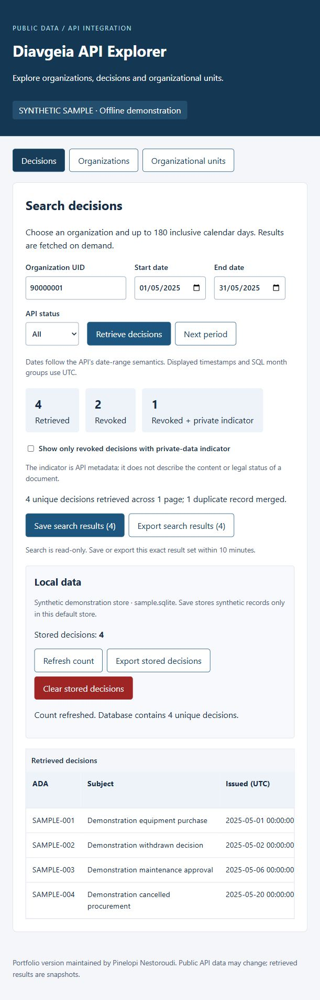
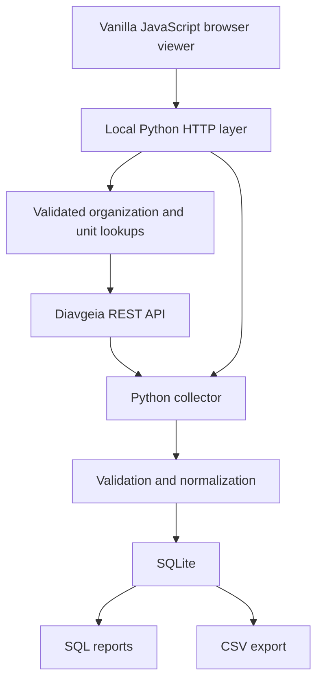

# Diavgeia API Explorer & Data Pipeline

Explore Greek public-sector decisions and turn bounded API searches into validated,
deduplicated SQLite data and reusable reports. The project demonstrates the full
flow from an external REST API to structured storage and usable output.

## Features

- **Browser explorer:** organizations, university filtering, decisions by organization/date/status,
  active organizational units, and clearly labelled partial results.
- **Interactive data workflow:** explicitly save a validated search snapshot, refresh stored counts,
  download search/stored CSV files, and clear stored decisions after confirmation.
- **Python collector:** bounded pagination, field validation, normalization, retries, duplicate merging.
- **SQLite storage:** ADA-keyed upserts, database constraints, atomic ingestion and repeatable runs.
- **SQL analytics:** organization counts, monthly activity, revocations and private-data indicators.
- **CSV export:** UTF-8 output with spreadsheet formula protection.
- **Offline demonstration:** small, explicitly synthetic fixtures. No academic attachments or real personal records are included.



## Architecture



The browser uses a same-origin, loopback-only Python server. That server exposes
fixed routes to Diavgeia, so no browser extension or disabled browser
security is needed. It serves only an explicit list of web assets and never exposes
the database or project directory. Browser search does **not** write to SQLite;
only an explicit Save action or CLI collection persists records. Sample mode is explicit and never used
as a silent fallback for live failures.

## Technology stack

Python 3.11+, `urllib`, `http.server`, `sqlite3`, `csv`, `unittest`, SQLite, SQL,
HTML, CSS and vanilla JavaScript modules. No third-party runtime dependencies.
Node.js is not required to run the project. GitHub Actions runs the Python tests.

## Installation

Run all commands from the root of **this portfolio repository**. Requires Python
3.11 or newer with `venv` and SQLite support.

Windows PowerShell:

```powershell
python -m venv .venv
.\.venv\Scripts\Activate.ps1
python -m pip install -r requirements.txt
```

If PowerShell activation is restricted, use `.\.venv\Scripts\python.exe` in place
of `python` without changing your execution policy.

macOS / Linux:

```sh
python3 -m venv .venv
. .venv/bin/activate
python -m pip install -r requirements.txt
```

`requirements.txt` intentionally contains no packages: the standard library is sufficient.

## Usage

Start an offline browser demonstration:

```sh
python -m src serve --sample
```

Open <http://127.0.0.1:8000>. The header identifies synthetic sample mode. Search
organization `90000001`, from `2025-05-01` to `2025-05-31`.
Once the server is running, the data workflow needs no terminal commands:

1. **Retrieve decisions** to create a temporary server-held result snapshot. Search never saves.
2. **Save search results (N)** to upsert a complete snapshot into local SQLite.
   Sample mode asks you to confirm that the records are synthetic. Repeated saves update ADAs without duplicates.
3. **Export search results (N)** to download the exact snapshot, including all retrieved rows
   regardless of the display-only private-data filter. Partial results can be exported with a warning
   and a `-partial.csv` filename, but cannot be saved.
4. **Refresh count** or **Export stored decisions** in Local data. Stored export shows the current
   count for confirmation, then streams the complete database to a browser download.
5. **Clear stored decisions** to remove database rows after an explicit confirmation.
   Cancelling does nothing. The schema, current search results and earlier downloads remain.

Snapshots expire after 10 minutes; only the five newest are retained. Search again
if a snapshot expires or is evicted. Saved records remain until explicitly cleared.
Sample mode uses `data/local/sample.sqlite`; live mode uses `data/local/diavgeia.sqlite`.
Counts and export/clear actions apply to the current mode's database only.

Stop the server with Ctrl+C. To explore live API data instead:

```sh
python -m src serve
```

The live default organization is `99206919`. API labels/subjects retain their source
language; interface controls are English.

Run a complete offline collection, including pagination and duplicate merging:

```sh
python -m src collect --sample --org 90000001 --start 2025-05-01 --end 2025-05-31 --page-size 2
python -m src collect --sample --org 90000002 --start 2025-06-01 --end 2025-06-30 --page-size 2
python -m src report --db data/local/sample.sqlite
python -m src export --db data/local/sample.sqlite --output data/local/sample-decisions.csv
```

The first collection processes five observations into four unique records, merging
one intentional duplicate. The second adds two records. Repeating either command
does not increase the row count. `collect --sample` defaults to `data/local/sample.sqlite`;
live collection defaults to `data/local/diavgeia.sqlite`. An explicit `--db` always wins in either mode.
Report/export keep their existing live database default; specify `--db` for sample data.
All server-side databases and CLI outputs under `data/local/` are ignored by Git.
Browser CSV files go to your browser's download location.

Run the live CLI workflow:

```sh
python -m src collect --org 99206919 --start 2025-05-01 --end 2025-05-02 --page-size 2
python -m src report
python -m src export
```

`--status` accepts `all`, `published` or `revoked`. Defaults are 100 records/page and
20 pages; `--page-size` allows 1–500 and `--max-pages` allows 1–100. An incomplete
collection exits with code 1 and makes **no database changes**. Narrow the query
or explicitly increase the page limit. The browser uses a 20-page limit and can
display prior validated pages with a prominent partial-results warning.

## Data model

One table, `decisions`, keeps the model easy to inspect:

| Field | Meaning |
| --- | --- |
| `ada` | API stable decision identifier; primary key |
| `organization_id` | Source `organizationId`, stored as text |
| `subject` | Optional source subject |
| `protocol_number` | Optional source protocol number |
| `issued_at_utc` | Source epoch milliseconds converted to ISO 8601 UTC; nullable |
| `status` | Source status, normalized to uppercase |
| `private_data` | Source `privateData`: 1=true, 0=false, NULL=unknown |

ADA, organization and status are required. Missing optional fields remain NULL,
and invalid types fail validation. Within a run the last observation of an ADA
wins; across runs the latest collected representation replaces stored fields.
This is an idempotent snapshot, not a version-history archive. Absent records are
not deleted automatically. Unknown future status strings are retained.

No document downloads, tax identifiers, signers, emails, attachments or raw API
archives are persisted. Live subjects can still contain personal information:
keep local databases and exports private and review them before sharing.

## Example analysis

Run all examples against the sample with `python -m src report --db data/local/sample.sqlite`, or open SQLite with your preferred
SQL client and execute [sql/reports.sql](sql/reports.sql).

```sql
SELECT organization_id, COUNT(*) AS decisions
FROM decisions
GROUP BY organization_id
ORDER BY decisions DESC;

SELECT substr(issued_at_utc, 1, 7) AS month_utc, COUNT(*) AS decisions
FROM decisions
WHERE issued_at_utc IS NOT NULL
GROUP BY month_utc;
```

The two sample collections yield 4 decisions for `90000001`, 2 for `90000002`,
4 in May and 2 in June. Two decisions are revoked; one of those has
`private_data=1`. This indicator is source metadata, not a conclusion about
privacy law, document contents, expenditure or organizational performance.
All counts describe only the collected snapshot. Trend SQL compares observed
months; missing months are not filled with zero.

## Tests

```sh
python -m unittest discover -s tests -v
```

Tests use synthetic fixtures and mocked HTTP responses, plus a temporary loopback
server. They do not contact Diavgeia. They cover pagination, malformed responses,
retry limits, missing fields, date boundaries, deduplication, idempotency, database
constraints/rollback, CSV safety and local route restrictions.
Snapshot lifecycle, explicit saves, partial-result restrictions, streamed export consistency,
clear confirmation/schema preservation and sample/live defaults are tested too.

## Screenshots

All screenshots use explicitly labelled synthetic data, without browser chrome,
terminal usernames, local paths or academic materials.

- [University lookup](docs/screenshots/organizations.png)
- [Active organizational units](docs/screenshots/units.png)
- [Mobile layout](docs/screenshots/mobile.png)
- [Clear confirmation](docs/screenshots/clear-confirmation.png)
- [Partial results and export controls](docs/screenshots/partial-results.png)

Capture instructions and additional suggested shots are in
[docs/screenshots/README.md](docs/screenshots/README.md).

## Project background

The original idea began as an academic team project exploring Diavgeia.
This separately maintained portfolio edition refactors that concept and adds
the Python collection, validation, SQLite and reporting workflow. Original academic
materials are kept privately outside this repository.

## My contribution

Portfolio owner: **Pinelopi Nestoroudi**.

My contribution in this portfolio edition is the refactor and extension of the
original concept: modular browser integration, controlled local HTTP access,
Python collection and normalization, SQLite storage, SQL reports, CSV export,
tests and documentation. This statement describes the portfolio edition; it does
not claim sole authorship of the original team project. Historical individual
contributions to the original assignment are not asserted here.

## Limitations

- The server is for local use and is bound to loopback only.
- API availability and changing results can affect retrieval completeness.
- Date ranges allow the same start and end date, up to 180 inclusive days.
  Stored timestamps and monthly reports use UTC.
- Live subjects may contain personal information. Local databases and exports are ignored by Git.

See [technical notes](docs/TECHNICAL_NOTES.md) for API contracts, retry limits,
source-date semantics, snapshot behavior and export details. Recorded checks are
in [technical verification](docs/VERIFICATION.md).
